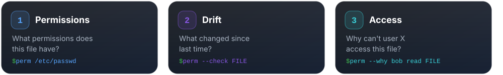
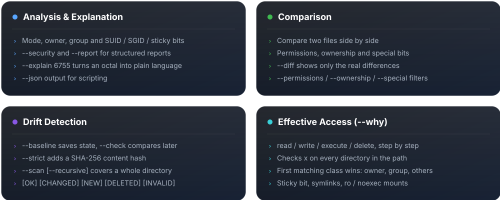
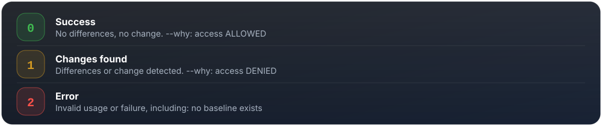

<div align="center">



<p align="center">
  
</p>

<p align="center">
  
  
  
  
</p>

<p align="center">
A Bash CLI that <b>explains Linux file permissions</b>, <b>detects permission drift</b>,<br/>
and tells you <b>why</b> a user can or cannot access a file.<br/>
One script. No dependencies beyond standard GNU/Linux tools. Targets Ubuntu/Linux.
</p>

</div>

<p align="center"></p>

<p align="center"></p>

<p align="center">
  
</p>

<p align="center"></p>

<p align="center">
  
</p>

<p align="center"></p>

```bash
git clone https://github.com/Kourosh-NF/perm.git
cd perm
chmod +x perm
./perm --help
```

Optional: install it system-wide.

```bash
sudo install -m 755 perm /usr/local/bin/perm
```

<p align="center"></p>

<p align="center">
  
</p>

<details>
<summary>Copy the synopsis as plain text</summary>

```text
perm [OPTIONS] PATH
perm --quiet PATH
perm --compare [OPTIONS] FILE1 FILE2
perm --explain VALUE
perm --baseline [--force] [--strict] PATH
perm --check [--json] PATH
perm --scan [--recursive] [--force] DIR
perm --scan [--recursive] --check [--json | --changes-only] DIR
perm --list [--json]
perm --remove PATH
perm --why [--json] USER ACTION PATH
```

</details>


```bash
perm /etc/passwd
perm --security /etc/passwd
perm --report /etc/passwd
perm --quiet /etc/passwd          # permission string only
perm --json /etc/passwd

perm --explain 755
perm --explain 6755
```


```bash
perm --compare file1 file2
perm --compare --permissions file1 file2
perm --compare --special file1 file2
perm --compare --diff file1 file2   # only the real differences
```


```bash
perm --baseline /usr/bin/sudo
perm --check /usr/bin/sudo
perm --baseline --strict /usr/bin/sudo     # also track content (SHA-256)

perm --scan --recursive /etc
perm --scan --recursive --check --changes-only /etc

perm --list
perm --remove /usr/bin/sudo
```


```bash
perm --why bob read /srv/app/data.txt
perm --why www-data execute /usr/local/bin/tool
perm --why alice delete /tmp/report.txt
perm --why 1001 w /var/www/index.html      # numeric UID and short action work too
```

<p align="center"></p>

<p align="center">
  
</p>

<p align="center">
  
</p>

<p align="center">
  
</p>

<p align="center"></p>

<p align="center">
  
</p>

<p align="center">Set <code>NO_COLOR=1</code> to disable colored output. Colors are also off when output is not a terminal.</p>

<p align="center"></p>

- ACLs are detected (a warning is shown) but **not** evaluated
- SELinux/AppArmor, Linux capabilities and `chattr +i` are not considered
- `--strict` (content hash) works on regular files only and is not supported with `--scan`
- Baselines are stored in `${XDG_DATA_HOME:-~/.local/share}/perm/baselines/`
- `perm` is a lightweight metadata checker, **not** a replacement for AIDE, Tripwire or SELinux tooling

<p align="center"></p>

<p align="center">Made by <a href="https://github.com/Kourosh-NF">Kourosh</a>, an IT student learning Linux, networking and infrastructure.</p>

<p align="center">
  <a href="mailto:kouroshnf87@gmail.com"></a>
</p>

<p align="center">
  <a href="https://t.me/albernfnx"></a>
</p>

<p align="center">
  <a href="https://github.com/Kourosh-NF"></a>
</p>

<p align="center">
  
</p>
